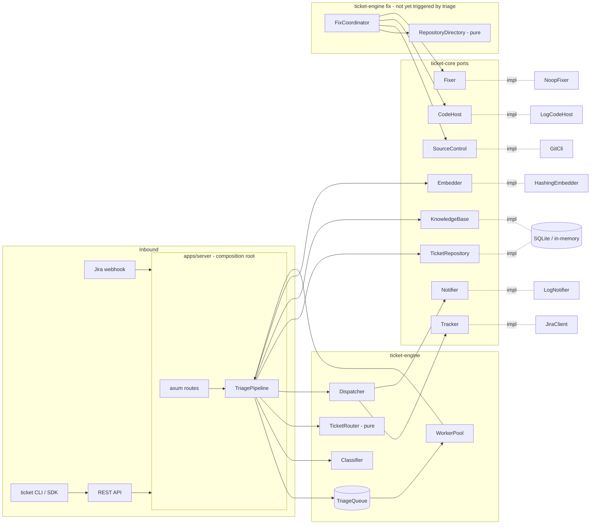
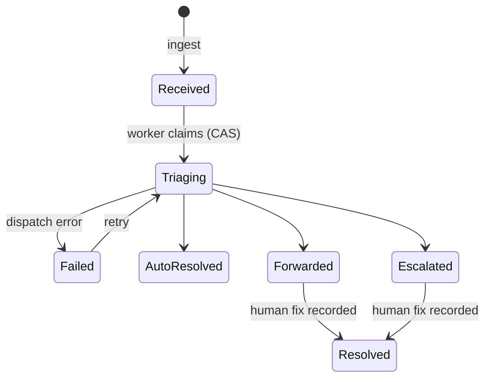

# Architecture

## Goals

1. **Always-on intake.** A long-running server accepts tickets from many
   external clients: Jira webhooks today, other trackers and direct API
   callers later.
2. **Triage by precedent.** Read the ticket, find similar resolved tickets
   (retrieval), assess severity, and decide whether to auto-resolve, forward
   to intermediate support, or escalate to an expert.
3. **Learn.** Every human resolution becomes new knowledge.
4. **Modular.** Each new client, tracker, store or model is a new adapter
   behind an existing trait. The engine does not change.

## Style: hexagonal (ports and adapters)



* **`ticket-core`** holds the domain types (`Ticket`, `Severity`,
  `RoutingDecision`, ...) and the **port traits**. It has no I/O and no
  framework dependencies.
* **`ticket-engine`** holds the application logic, written only against those traits.
* **Adapters** (`ticket-storage`, `ticket-retrieval`, `ticket-jira`, `ticket-git`)
  implement the ports. Their heavy dependencies (sqlx, reqwest) stay out of
  the engine.
* **`apps/server`** is the only place that names concrete adapters
  (`bootstrap.rs`). Swapping SQLite for Postgres, or the hashing embedder
  for a neural model, is a change there plus a new adapter crate.

### Why `Arc<dyn Trait>` and not generics

Adapters are chosen **from configuration at runtime** (`database.url =
"memory"` vs SQLite, any number of Jira connectors), and a single process
serves several clients with different trackers. Trait objects make that
direct. The cost of one virtual call per I/O operation is negligible next
to the I/O itself. Pure, hot-path logic (`TicketRouter::decide`,
`RuleBasedClassifier::classify_ticket`, `Embedding::cosine`) is plain
synchronous code with no dynamic dispatch.

`async-trait` is still used for the ports because native `async fn` in
traits is not yet dyn-compatible on stable Rust.

## The ticket model

A `NewTicket` (inbound) and a `Ticket` (stored) carry:

| Group      | Fields                                                                     |
|------------|----------------------------------------------------------------------------|
| Identity   | `id`, `client` (tenant), `external_ref { system, key }`                    |
| Content    | `title`, `description`, `kind` (bug, incident, feature_request, task, question, other) |
| Who        | `reporter { name, email, external_id }`. Plain strings are still accepted. |
| Triage     | `reported_severity` (a hint), `labels`, `components`                       |
| Code       | `code_context { repository, git_ref, paths, version }`                     |
| Evidence   | `links [{ url, title }]`, `metadata` (bounded string map)                  |
| Time       | `reported_at` (upstream), `created_at` / `updated_at` (ours), `status`     |

`NewTicket::validate` bounds every collection and string. It also rejects
code paths that are absolute, contain `..`, or look like options, and links
that are not absolute `http(s)` URLs. In SQLite, `components`,
`code_context`, `links` and `metadata` share one JSON `details` column, so
new optional fields need no migration.

## Ticket lifecycle



* **Ingest** validates input, deduplicates by `ExternalRef` (webhooks are
  delivered at least once), persists the ticket as `received` and enqueues
  its id. The HTTP response is `202 Accepted`. Triage is asynchronous.
* **Claim**: `TicketRepository::transition(id, [Received, Failed], Triaging)`
  is an atomic compare-and-set, so a ticket enqueued twice is processed once.
* **Recovery**: on start-up, tickets stuck in `triaging` are reset and every
  `received` ticket is re-queued. The in-process queue therefore never loses
  work, because the database is the source of truth.

## The triage pipeline

```
embed(title + description)
  -> KnowledgeBase::search(top_k)                    retrieval
  -> Classifier::classify(ticket, matches)            severity + category
  -> TicketRouter::decide(classification, matches)    pure decision
  -> save TriageReport (append-only audit)
  -> Dispatcher::dispatch                             Tracker + Notifier
  -> status = decision.resulting_status()
```

### Severity (`RuleBasedClassifier`)

Three signals, combined by **maximum** (under-triage costs more than over-triage):

1. Keyword rules on word boundaries (`"security breach"` gives critical/security).
2. The reporter's priority (a Jira `Highest` maps to critical), treated as a hint.
3. A similarity-weighted vote over the severities of matching past tickets.

Confidence rises with agreement between signals. Every contribution is
recorded in `rationale` so decisions are auditable.

### Routing (`TicketRouter`, pure)

| Condition (checked in order)                                                         | Decision                     |
|--------------------------------------------------------------------------------------|------------------------------|
| severity >= `escalate_severity` (default critical)                                   | Escalate to category expert  |
| best score >= `auto_resolve_threshold` (0.90) **and** fix automatable **and** severity <= `max_auto_resolve_severity` (medium) | Auto-resolve |
| best score >= `forward_threshold` (0.65)                                             | Forward to L2, with suggested fix |
| otherwise (novel)                                                                    | Escalate to category expert  |

Auto-resolution is opt-in per fix: a human must mark a resolution
`automatable`. Fixes learned from Jira are never automatable by default,
and echoes of the service's own Jira transitions are ignored, so the system
never learns from itself.

### Retrieval (the "R" in RAG)

`Embedder` turns text into vectors and `KnowledgeBase` finds nearest
neighbours by cosine similarity.

* Today: `HashingEmbedder`, an offline, deterministic, lexical baseline with
  no external dependency, plus a brute-force scan in SQLite. This is fine to
  roughly 10^4 entries.
* Next: a neural embedder (an HTTP embedding API or a local ONNX model) in
  `ticket-retrieval` behind a cargo feature, and a vector index (`sqlite-vec`,
  Postgres with `pgvector`, or Qdrant) behind `KnowledgeBase`.
  `Embedder::model_id` exists so stored vectors can be re-indexed when the
  model changes.
* Later: **generation**. An LLM-backed `Classifier`, and a step that drafts
  the reply or fix from the retrieved tickets, both plugging into existing
  ports with the rule-based path kept as a fallback.

## Multi-client design

* Every ticket carries a `ClientId` (tenant).
* Every external ticket carries an `ExternalRef { system, key }`. `system`
  is the **connector instance name** (for example `jira-acme`), and the
  `Dispatcher` uses it to pick the `Tracker` that writes back.
* Connectors are configured as a map (`[connectors.jira.<name>]`). Two
  customers on different Jira sites are two entries. Each gets its own
  webhook URL, secret and credentials.
* **Adding a new tracker** (ServiceNow, Zendesk, GitHub Issues) means a new
  `crates/connectors/<name>` crate with a config struct, a webhook parser
  producing `NewTicket`, and a `Tracker` impl. Then one route and a few
  lines in `bootstrap.rs`. Nothing in core or the engine changes.
* **Standalone clients** use the REST API directly, or the `ticket-client`
  SDK, which shares its request/response types with the server through
  `ticket-api`, so the two cannot drift.

## Code changes (foundation for autonomous fixing)

`FixCoordinator::run(ticket)` follows these steps:

1. **Resolve** a repository with `RepositoryDirectory`, a pure function. It
   checks the ticket's `code_context.repository` first, then
   `components`, then the client's only repository. It only considers
   repositories whose `clients` list allows the ticket's client. Tickets
   name repository *ids*, never remotes.
2. **Prepare** a workspace (`SourceControl::prepare`). `GitCli` keeps one
   bare clone per repository (`cache_dir/<id>.git`) and fetches it, then
   adds a linked worktree at `workspace_dir/<ticket-id>` on a new branch
   `ticket/<ticket-id>` from `origin/<default_branch>`. A per-repository
   lock serialises operations on the shared clone.
3. **Fix**: `Fixer::attempt` edits files in the worktree. `NoopFixer` is
   the placeholder.
4. **Commit** everything (returns `None` if the tree is unchanged), then
   **push** the branch, then **open a change request** (`CodeHost`).
   `LogCodeHost` only logs.
5. **Release**: the worktree and local branch are always removed, even
   if an earlier step failed. Pushed branches stay on the remote.

`GitCli` hardening:

* Arguments are passed as a vector, never through a shell, with `--`
  before paths and refspecs. Branch names, repository ids and commit ids
  are validated types.
* `core.hooksPath=/dev/null`, `core.fsmonitor=false`, `--no-verify` and
  `--no-gpg-sign` ensure that repository content cannot run code in the
  service. A test plants hooks in the clone to prove this.
* Diffs use `--no-ext-diff --no-textconv`. `GIT_TERMINAL_PROMPT=0` and a
  closed stdin keep git from waiting for input. Every command has a timeout
  and is killed when it expires.
* Startup fails if repositories are configured but `git --version` cannot
  run. With no repositories configured, git is never invoked.

## Security baseline

* Optional bearer token on `/v1` (compared in constant time).
* Jira webhooks are verified with HMAC-SHA256 (`X-Hub-Signature`) over the raw body.
* 1 MiB request body limit, and input length validation on tickets.
* Secrets are redacted from `Debug` output and can be supplied via environment variables.
* 5xx responses never leak internal error text. It is logged instead.
* Jira issue keys are validated before being placed in request paths.

## Testing strategy

| Layer               | Tests                                                                 |
|---------------------|-----------------------------------------------------------------------|
| Domain              | Unit tests on invariants, parsing and serialisation                   |
| Router / classifier | Exhaustive unit tests (pure functions)                                |
| Storage             | One **contract suite** run against every adapter (SQLite, in-memory)  |
| Engine              | End-to-end pipeline with real adapters; only the tracker is recorded  |
| HTTP                | Real server on an ephemeral port, driven through the client SDK       |
| Jira                | Real webhook payloads, real HMAC signatures, ADF round-trips          |

## Roadmap

1. **Durable queue / outbox**: replace the in-process channel with a
   DB-backed outbox or a broker, so several replicas can run.
   Claim expiry would use `updated_at`.
2. **Retry policy**: backoff for `failed` tickets, plus a
   `POST /v1/tickets/{id}/retriage` endpoint.
3. **Postgres adapter** with `pgvector`, run against the existing contract suite.
4. **Neural embeddings** and an **LLM classifier and reply drafting**.
5. **Notifiers**: Slack, email, PagerDuty for critical escalations.
6. **More connectors**: ServiceNow, Zendesk, GitHub Issues.
7. **Per-client policy**: thresholds, rules and escalation directories keyed by `ClientId`.
8. **Observability**: OpenTelemetry traces, Prometheus metrics (auto-resolve
   rate, time to triage, escalation mix).
9. **Autonomous fixing** (next stage, built on `FixCoordinator`):
   * an LLM-backed `Fixer` that reads the ticket, `code_context.paths` and
     retrieved precedents, and edits the worktree;
   * a sandboxed test run in the workspace before commit (a container, with
     no network and no secrets);
   * a routing decision such as `AttemptFix` for eligible tickets (by
     `kind`, severity, and a per-repository opt-in), with escalation as the
     fallback;
   * a GitHub/GitLab `CodeHost` that opens real pull requests, with the PR
     URL posted back through `Tracker::comment`;
   * a retry policy for branches that were already pushed (currently a second
     push of `ticket/<id>` from a new base is rejected as non-fast-forward);
   * persisting `FixResult` next to the `TriageReport`.
